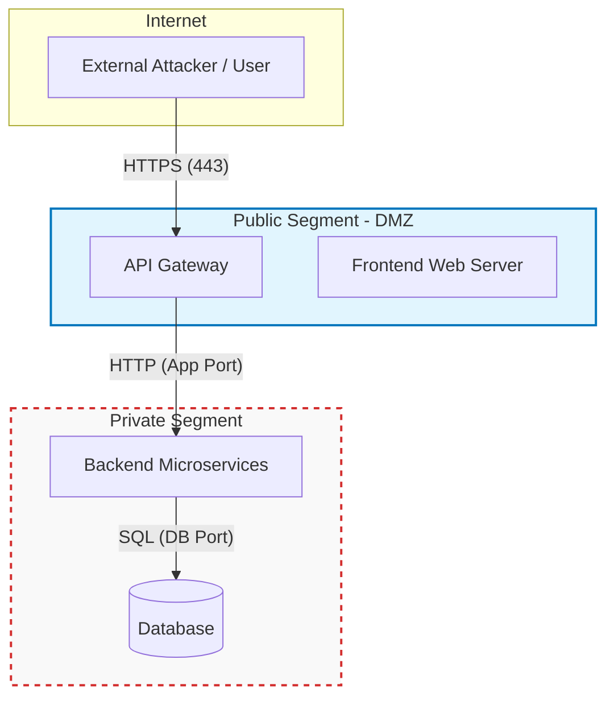

# Security Pattern: Network Segmentation

## 1. Pattern Description

**Network Segmentation** divides the system's network into isolated zones, each with its own trust level, and controls all traffic that crosses between them. Routers, firewalls and access control lists (ACLs) separate the zones. Only explicitly allowed flows can pass from one zone to another.

In our deployment the network is split into two segments:

| Segment | Purpose | Components | Exposure |
|---|---|---|---|
| **Public segment (DMZ)** | Receives traffic from the Internet | Reverse proxy / API Gateway, Frontend (web server) | Reachable from the Internet only on HTTPS (443) |
| **Private segment** | Hosts business logic and data | Backend microservices, Databases, Message broker | Not reachable from the Internet. Accepts traffic only from the public segment on specific ports |

### Network configuration

```
                    Internet
                       │
                ┌──────▼──────┐
                │ Edge Router │  Allows only TCP 443 inbound
                │ + Firewall  │
                └──────┬──────┘
                       │
   ┌───────────────────▼────────────────────┐
   │      PUBLIC SEGMENT (DMZ) 10.0.1.0/24  │
   │  ┌───────────────┐   ┌──────────────┐  │
   │  │ API Gateway / │   │   Frontend   │  │
   │  │ Reverse Proxy │   │  Web Server  │  │
   │  └───────┬───────┘   └──────────────┘  │
   └──────────┼─────────────────────────────┘
              │
       ┌──────▼───────┐
       │ Internal     │  Allows only Gateway → Backend
       │ Router + ACL │  on application ports. Denies everything else
       └──────┬───────┘
              │
   ┌──────────▼─────────────────────────────┐
   │      PRIVATE SEGMENT 10.0.2.0/24       │
   │  ┌──────────┐ ┌──────────┐ ┌────────┐  │
   │  │ Service A│ │ Service B│ │   DB   │  │
   │  └──────────┘ └──────────┘ └────────┘  │
   └────────────────────────────────────────┘
```

### Traffic rules

| # | Source | Destination | Port / Protocol | Action |
|---|---|---|---|---|
| 1 | Internet | API Gateway (public) | 443 / HTTPS | Allow |
| 2 | Internet | Any private host | Any | **Deny** |
| 3 | API Gateway (public) | Backend services (private) | Application ports (e.g. 8000–8080) / HTTP | Allow |
| 4 | Backend services (private) | Database (private) | DB port (e.g. 5432) | Allow |
| 5 | Public segment | Database (private) | Any | **Deny** |
| 6 | Anything else | Anything | Any | **Deny** (default deny) |

Private hosts have no public IP addresses. The only route from the Internet into the private segment goes through the API Gateway and the internal router.

## 2. Quality Scenario (Security)

**Attribute addressed:** **Confidentiality**. Integrity also benefits as a secondary effect.

| Element | Description |
|---|---|
| **Source** | An external, unauthorized attacker on the Internet |
| **Stimulus** | The attacker scans the system's IP range and tries to connect directly to the database and backend services to read sensitive data |
| **Artifact** | The private segment: backend microservices and the database |
| **Environment** | The system is running normally in production |
| **Response** | The edge router/firewall and the internal router's ACLs drop every connection attempt that does not target the API Gateway on port 443. The attempts are logged. Private components are not visible to the attacker |
| **Response Measure** | 100% of direct connection attempts from the Internet to private-segment hosts are blocked. Zero records are exposed. The blocked attempts are logged and an alert is raised within 1 minute |

### How the pattern resolves the scenario

1. **No direct exposure.** Databases and backend services sit in the private segment, with no public IPs and no route from the Internet. The attacker cannot reach the data store, so they cannot read the data. This protects **confidentiality**.
2. **Single, controlled entry point.** All external traffic must pass through the API Gateway in the public segment. The gateway can apply authentication, validation and rate limiting before forwarding requests.
3. **Default-deny rules between segments.** The internal router accepts only explicitly allowed flows (Gateway → Backend, Backend → DB). If the public segment is compromised, the attacker still cannot open arbitrary connections to the database. This limits lateral movement and the blast radius.
4. **Detection.** The routers and firewalls log blocked traffic, so the team can see and respond to scanning or intrusion attempts.

The pattern reduces the attack surface from the whole system to one hardened component (the API Gateway). This is how it meets the response measure: no sensitive data is reachable from outside.


## 3. Architectural View

This view illustrates the deployment architecture after applying the Network Segmentation pattern. The system is divided into two distinct zones to enforce security policies and restrict unauthorized access to critical infrastructure.

### 3.1 Component Diagram



### 3.2 Architectural Description

The architecture enforces a strict isolation policy:

1.  **Public Segment (DMZ):** Acts as the entry point. Only the **API Gateway** and **Frontend** are exposed. The public segment is accessible from the Internet, but only via HTTPS on port 443.
2.  **Private Segment:** Contains the **Backend** and **Database**. These components lack public IP addresses and are not routable from the Internet.
3.  **Controlled Traffic Flow:** Traffic must follow a specific path: *Internet -> API Gateway -> Backend -> Database*. Any attempt to bypass the API Gateway to reach the Backend or Database is dropped at the network boundary (Firewall/ACL).
4.  **Security Impact:** By segmenting the network, we reduce the attack surface. An attacker who compromises the public segment cannot perform lateral movement to the database, as the internal routing rules explicitly block unauthorized inter-segment communication.

Sections 3 to 5 are left for the architectural view and the base implementation guide.

## 6. Implementation: core (internal router and ACL)

The core lives in [nucleo](nucleo). It reuses the gateway, frontend, backend and attacker images from [lab-pruebas](lab-pruebas) and adds the piece that Docker networks alone cannot give (see section 7.6): an **internal router with a default-deny ACL** between the public segment and the private segment.

### 6.1 What changes compared with the harness "after" compose

| Item | Harness after (7.4) | Core |
|---|---|---|
| Gateway networks | `internet`, `public`, `private` | `internet`, `public` only |
| Path gateway → backend | Same Docker network | Through the router `10.0.1.254` → `10.0.2.254` |
| Gateway → db:5432 | Open (`CONNECTED`) | **Dropped by the ACL and logged** |
| Logging of blocked traffic | None | Each denied packet in `docker compose logs router` |

Addresses:

| Host | public `10.0.1.0/24` | private `10.0.2.0/24` (internal) |
|---|---|---|
| gateway | `10.0.1.10` | — |
| frontend | `10.0.1.20` | — |
| router | `10.0.1.254` | `10.0.2.254` |
| backend | — | `10.0.2.10` |
| db | — | `10.0.2.20` |

### 6.2 Steps

1. Create the router image (`nucleo/router/Dockerfile`). It only needs `iptables`, `iproute2` and `tcpdump`:

   ```dockerfile
   FROM alpine:3.20
   RUN apk add --no-cache iptables iproute2 tcpdump
   COPY acl.sh /acl.sh
   RUN chmod +x /acl.sh
   ENTRYPOINT ["/acl.sh"]
   ```

2. Write the ACL (`nucleo/router/acl.sh`). It implements the traffic rules of section 1: default deny, one allowed flow (rule 3), and log + drop for everything else (rules 2, 5 and 6). Rule 4 (backend → db) is inside the private segment and does not cross the router.

   ```sh
   # Default deny (rule 6)
   iptables -P INPUT DROP
   iptables -P FORWARD DROP
   iptables -P OUTPUT ACCEPT

   iptables -A INPUT -i lo -j ACCEPT
   iptables -A INPUT -m conntrack --ctstate ESTABLISHED,RELATED -j ACCEPT

   # Replies to connections that were already allowed
   iptables -A FORWARD -m conntrack --ctstate ESTABLISHED,RELATED -j ACCEPT
   iptables -A FORWARD -m conntrack --ctstate INVALID -j DROP

   # Rule 3: gateway (DMZ) -> backend (private), application port only
   iptables -A FORWARD -s "$GATEWAY_IP" -d "$BACKEND_IP" -p tcp --dport "$BACKEND_PORT" \
     -m conntrack --ctstate NEW -j ACCEPT

   # Rules 2, 5 and 6: log and drop every other flow
   iptables -A FORWARD -m limit --limit 30/min --limit-burst 60 \
     -j NFLOG --nflog-group 1 --nflog-prefix "SEG-DENY-FWD"
   iptables -A FORWARD -j DROP
   iptables -A INPUT -m limit --limit 30/min --limit-burst 60 \
     -j NFLOG --nflog-group 1 --nflog-prefix "SEG-DENY-IN"
   iptables -A INPUT -j DROP

   # Return path: private hosts see the router as the source,
   # so they need no route back to the DMZ
   iptables -t nat -A POSTROUTING -s "$PUBLIC_NET" -d "$PRIVATE_NET" -j MASQUERADE

   # Blocked attempts are printed in real time
   exec tcpdump -n -l -tttt -i nflog:1
   ```

   The log uses `NFLOG` + `tcpdump -i nflog:1` because the classic `LOG` target writes to the kernel log of the Docker host, which is not visible from the container.

3. Declare the router in compose with forwarding enabled and a fixed address in each segment:

   ```yaml
   router:
     build: ./router
     cap_add: [NET_ADMIN, NET_RAW]
     sysctls:
       net.ipv4.ip_forward: "1"
     environment:
       GATEWAY_IP: 10.0.1.10
       BACKEND_IP: 10.0.2.10
       BACKEND_PORT: "8080"
     networks:
       public:
         ipv4_address: 10.0.1.254
       private:
         ipv4_address: 10.0.2.254
   ```

4. Take the gateway out of `private`. It keeps the backend name through `extra_hosts`, so `nginx.conf` does not change (`proxy_pass http://backend:8080`):

   ```yaml
   gateway:
     build: ../lab-pruebas/gateway
     ports:
       - "443:443"
     extra_hosts:
       - "backend:10.0.2.10"
     networks:
       internet: {}
       public:
         ipv4_address: 10.0.1.10
   ```

5. Give the gateway a route to the private segment through the router. A one-shot container shares the gateway's network namespace, adds the route and exits. The gateway itself never gets `NET_ADMIN`, so a compromised gateway cannot change its own routes:

   ```yaml
   gateway-route:
     build: ./router
     entrypoint: ["ip", "route", "replace", "10.0.2.0/24", "via", "10.0.1.254"]
     network_mode: "service:gateway"
     cap_add: [NET_ADMIN]
     restart: "no"
   ```

6. Keep `private` as an internal network with fixed addresses for backend (`10.0.2.10`) and db (`10.0.2.20`). Do **not** mark `public` as `internal`: Docker then drops packets on that bridge whose destination is outside `10.0.1.0/24`, which includes the gateway → `10.0.2.10` traffic going to the router.

   ```yaml
   networks:
     internet:
     public:
       ipam:
         config:
           - subnet: 10.0.1.0/24
     private:
       internal: true
       ipam:
         config:
           - subnet: 10.0.2.0/24
   ```

7. Start it and check the ACL:

   ```sh
   cd nucleo
   docker compose up -d --build
   docker compose exec router iptables -L FORWARD -v -n --line-numbers
   docker compose logs -f router      # denied attempts
   ```

### 6.3 Result

Evidence in [evidencias/nucleo](evidencias/nucleo).

| Flow | Expected | Observed |
|---|---|---|
| Attacker → `https://gateway:443/` | Allow | `patient-record-001` |
| Gateway → backend:8080 (via router) | Allow (rule 3) | `patient-record-001` |
| Backend → db:5432 | Allow (rule 4) | `CONNECTED` |
| Gateway → db `10.0.2.20:5432` | Deny (rule 5) | `curl: (28) Connection timed out`, logged |
| Gateway → backend `10.0.2.10:22` | Deny (rule 6) | timeout, logged |
| Frontend → backend `10.0.2.10:8080` | Deny (rule 5) | timeout |
| Attacker `nmap` `10.0.2.10`, `10.0.2.20`, `10.0.1.254` | Deny (rule 2) | all ports `filtered` |

The gateway → db attempt from section 7.6 now shows up in the router log within a second:

```text
2026-11-10 02:35:31.152027 IP 10.0.1.10.48744 > 10.0.2.20.5432: Flags [S], seq 2988637248, win 64240, ...
2026-11-10 02:35:43.441971 IP 10.0.1.10.37188 > 10.0.2.10.22: Flags [S], seq 230008188, win 64240, ...
```

The ACL counters confirm that only rule 3 opened new connections and the rest fell into the log + drop rules:

```text
num   pkts bytes target  prot  source      destination
1       36  3010 ACCEPT  0     0.0.0.0/0   0.0.0.0/0    ctstate RELATED,ESTABLISHED
2        0     0 DROP    0     0.0.0.0/0   0.0.0.0/0    ctstate INVALID
3        4   240 ACCEPT  6     10.0.1.10   10.0.2.10    tcp dpt:8080 ctstate NEW
4       27  1620 NFLOG   0     0.0.0.0/0   0.0.0.0/0    nflog-prefix SEG-DENY-FWD
5       27  1620 DROP    0     0.0.0.0/0   0.0.0.0/0
```

Known limits: the route in step 5 is lost if the gateway container is recreated, so run `docker compose up -d gateway-route` again after restarting the gateway. Because of `MASQUERADE`, the backend sees `10.0.2.254` as the client; the real client address is still in the gateway's access log.

## 7. Tests and results

These checks belong to the test harness in [lab-pruebas](lab-pruebas). They do not replace the team compose. The harness has an attacker, a TLS gateway on port 443, a frontend in the DMZ, a backend on port 8080, and Postgres on port 5432. The backend answers with `{"service":"backend","data":"patient-record-001"}`. That string is the sensitive record used below.

Two topologies, the same commands:

- **Before.** One flat network. The attacker can resolve and reach every service. See [docker-compose.before.yml](lab-pruebas/docker-compose.before.yml).
- **After.** `internet` (attacker and gateway only), `public` `10.0.1.0/24` (gateway and frontend), and `private` `10.0.2.0/24` with `internal: true` (gateway, backend, and database). See [docker-compose.after.yml](lab-pruebas/docker-compose.after.yml).

Complete transcripts are in [evidencias/antes](evidencias/antes) and [evidencias/despues](evidencias/despues). The blocks below are the commands and the lines that show the result. `openssl` exit code 1 against a port that is not TLS still proves the TCP connection when the output contains `CONNECTED`.

### 7.1 What is verified

The quality scenario in section 2: an external attacker must not read the private segment directly. The only external success is HTTPS/443 on the gateway. The legitimate path stays up: gateway to backend, backend to database. A host that is only in the public segment (the frontend) must not reach the private segment.

### 7.2 How to run

Docker is required. From `lab-pruebas`:

```powershell
.\run-tests.ps1
```

The script starts each compose project, runs the checks from the `attacker` service, writes one file per command, then removes the stack. `nmap` uses `-sT` (TCP connect), so the container does not need raw sockets.

### 7.3 Before: flat network

From the attacker, `nmap` sees the backend and the database listening:

```text
PORT     STATE  SERVICE
443/tcp  closed https
5432/tcp closed postgresql
8080/tcp open   http-proxy
```

`nmap -4 -sT -Pn -p 443,8080,5432 backend` in [evidencias/antes/nmap-backend.txt](evidencias/antes/nmap-backend.txt). The database scan shows `5432/tcp open`:

```text
PORT     STATE  SERVICE
443/tcp  closed https
5432/tcp open   postgresql
8080/tcp closed http-proxy
```

Direct `curl` returns the record without going through the gateway ([evidencias/antes/curl-backend.txt](evidencias/antes/curl-backend.txt)):

```text
COMMAND: curl -sS -D - --connect-timeout 5 --max-time 8 http://backend:8080/

HTTP/1.1 200 OK
Content-Type: application/json

{"service":"backend","data":"patient-record-001"}
```

The same body is returned by `curl -k https://gateway:443/` ([evidencias/antes/curl-gateway.txt](evidencias/antes/curl-gateway.txt)).

`openssl s_client -connect gateway:443 -servername gateway` completes TLS. The certificate subject is `CN=gateway` and verification fails only because the certificate is self-signed ([evidencias/antes/openssl-gateway.txt](evidencias/antes/openssl-gateway.txt)):

```text
CONNECTED(00000003)
subject=CN=gateway
issuer=CN=gateway
Verification error: self-signed certificate
```

`openssl s_client -connect backend:8080` and `openssl s_client -connect db:5432` both print `CONNECTED` and then fail the handshake (`wrong version number` on 8080, `unexpected eof` on 5432). The ports are open. They are not TLS. The same `CONNECTED` result appears from the gateway, the backend, and the frontend ([evidencias/antes/internal-gateway-to-db.txt](evidencias/antes/internal-gateway-to-db.txt), [evidencias/antes/internal-backend-to-db.txt](evidencias/antes/internal-backend-to-db.txt), [evidencias/antes/internal-frontend-to-db.txt](evidencias/antes/internal-frontend-to-db.txt)).

### 7.4 After: segmented network

From the attacker, the gateway is the only host that answers, and only on 443 ([evidencias/despues/nmap-gateway.txt](evidencias/despues/nmap-gateway.txt)):

```text
PORT     STATE  SERVICE
443/tcp  open   https
5432/tcp closed postgresql
8080/tcp closed http-proxy
```

`backend` and `db` are not in the attacker's DNS:

```text
COMMAND: nmap -4 -sT -Pn -p 443,8080,5432 --max-retries 1 --host-timeout 12s backend

Failed to resolve "backend".
```

The addresses recorded for the containers were `10.0.2.3` (backend) and `10.0.2.2` (database). Nmap prints the rDNS name `_gateway` for `10.0.2.2`. Every scanned port on both addresses is `filtered` ([evidencias/despues/nmap-backend-by-ip.txt](evidencias/despues/nmap-backend-by-ip.txt), [evidencias/despues/nmap-db-by-ip.txt](evidencias/despues/nmap-db-by-ip.txt)):

```text
COMMAND: nmap -4 -sT -Pn -p 443,8080,5432 --max-retries 1 --host-timeout 12s 10.0.2.3

PORT     STATE    SERVICE
443/tcp  filtered https
5432/tcp filtered postgresql
8080/tcp filtered http-proxy
```

`curl` to the backend name fails, and `curl` to the backend address does not connect ([evidencias/despues/curl-backend.txt](evidencias/despues/curl-backend.txt), [evidencias/despues/curl-backend-by-ip.txt](evidencias/despues/curl-backend-by-ip.txt)):

```text
COMMAND: curl -sS -D - --connect-timeout 5 --max-time 8 http://backend:8080/
curl: (6) Could not resolve host: backend

COMMAND: curl -sS -D - --connect-timeout 5 --max-time 8 http://10.0.2.3:8080/
curl: (7) Failed to connect to 10.0.2.3 port 8080 after 0 ms: Could not connect to server
```

`openssl` against `backend:8080` and `db:5432` fails in name lookup (`BIO_lookup_ex`, `connect:errno=22`) and never prints `CONNECTED` ([evidencias/despues/openssl-backend.txt](evidencias/despues/openssl-backend.txt), [evidencias/despues/openssl-db.txt](evidencias/despues/openssl-db.txt)).

The allowed path still returns the record. `curl -k https://gateway:443/` from the attacker, and `curl http://backend:8080/` from the gateway, both return `patient-record-001` ([evidencias/despues/curl-gateway.txt](evidencias/despues/curl-gateway.txt), [evidencias/despues/internal-gateway-to-backend.txt](evidencias/despues/internal-gateway-to-backend.txt)). `openssl s_client -connect gateway:443` again shows `subject=CN=gateway`, `TLSv1.3`, and `Verification error: self-signed certificate`.

From the backend, `openssl s_client -connect db:5432` prints `CONNECTED` ([evidencias/despues/internal-backend-to-db.txt](evidencias/despues/internal-backend-to-db.txt)). The database is reachable from the private segment.

From the frontend, which is only on `10.0.1.0/24`, the private names do not resolve ([evidencias/despues/internal-frontend-to-backend.txt](evidencias/despues/internal-frontend-to-backend.txt), [evidencias/despues/internal-frontend-to-db.txt](evidencias/despues/internal-frontend-to-db.txt)):

```text
COMMAND: curl -sS -D - --connect-timeout 5 --max-time 8 http://backend:8080/
curl: (6) Could not resolve host: backend
```

### 7.5 Comparison

| Check | Before | After |
|---|---|---|
| Attacker `nmap` gateway:443 | open | open |
| Attacker `nmap` gateway:8080 and :5432 | closed | closed |
| Attacker `nmap` backend:8080 | open | name not resolved; `10.0.2.3` filtered |
| Attacker `nmap` db:5432 | open | name not resolved; `10.0.2.2` filtered |
| Attacker `curl https://gateway:443/` | `patient-record-001` | `patient-record-001` |
| Attacker `curl http://backend:8080/` | `patient-record-001` | `Could not resolve host` |
| Attacker `openssl` gateway:443 | TLS, `CN=gateway`, self-signed | TLS, `CN=gateway`, self-signed |
| Attacker `openssl` backend:8080 and db:5432 | `CONNECTED` (port open, not TLS) | name lookup failed, no `CONNECTED` |
| Gateway to backend:8080 | record returned | record returned |
| Backend to db:5432 | `CONNECTED` | `CONNECTED` |
| Frontend to backend and db | record returned; db `CONNECTED` | names do not resolve |

The scenario holds for this harness. The attacker cannot read the private record except through the gateway on HTTPS/443. Hiding the name is not the control: the private addresses stay `filtered`, and `curl` to `10.0.2.3:8080` fails.

### 7.6 Gateway to database

In the after topology the gateway is attached to `private`, so `openssl s_client -connect db:5432` from that container still prints `CONNECTED` ([evidencias/despues/internal-gateway-to-db.txt](evidencias/despues/internal-gateway-to-db.txt)). Docker networks do not apply the ACL in section 1 that should deny the gateway's own connection to port 5432. That rule belongs to the core implementation. When it is in place, the same command should time out or be refused, while gateway to backend:8080 and backend to db:5432 stay open.

### 7.7 Running the same checks on the team compose

`run-tests.ps1` takes the compose file, the project name, and the host names. Example, once the team stack is up and includes an `attacker` service attached only to the external network (image with `curl`, `nmap`, and `openssl`):

```powershell
.\run-tests.ps1 `
  -ComposeFile ..\docker-compose.yml `
  -ProjectName team `
  -OutputDir ..\evidencias\equipo `
  -Phase custom `
  -GatewayHost <gateway-dns-name> `
  -BackendHost <backend-dns-name> `
  -DbHost <database-dns-name> `
  -GatewayPort 443 `
  -BackendPort 8080 `
  -DbPort 5432 `
  -SkipUp
```

`-SkipUp` leaves the team stack running. Internal checks use `docker compose exec` and expect `curl` and `openssl` inside the gateway, backend, and frontend containers. If a service is missing, that check is written as `SKIPPED` and the attacker checks still run. For the after picture, the attacker must not share a network with the backend or the database. The expected results are the After column in section 7.5, plus a denied gateway-to-database check once the ACL from section 7.6 exists.
